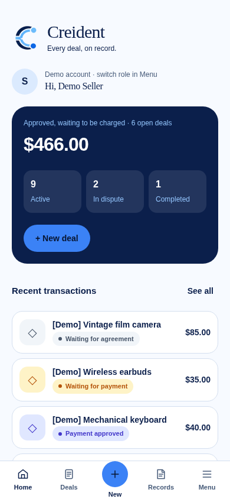

# Creident

<picture>
  <source media="(prefers-color-scheme: dark)" srcset="public/brand/symbol-dark.png">
  
</picture>

**Every deal, on record.**

**A dispute-mediation prototype for peer-to-peer sales of physical goods.**
Rules first, AI summarises evidence, a human confirms every dispute outcome, and every
action is recorded in a hash-chained, auditable log. Built for the PayPal AI Hackathon 2026
on the **PayPal Sandbox**.

> This is a hackathon prototype. It is not an escrow service, it does not hold
> anyone's money, and it does not handle real payments. PayPal authorizes the payment;
> the platform calls capture, void or refund according to the rules.



**Screens**

Captured from the running app with a fresh SQLite database, simulated PayPal,
and synthetic demo data. Mobile: 390 × 844, light. Desktop: 1440 × 900, dark.
The lead image uses the current Sapphire Flow brand kit. The older gallery below contains
illustrative captures from before the brand/R5 label updates; the fairness image
contains older replay results. Current label counts and metrics are in section 5 and
[`eval/report.md`](eval/report.md); neither is a live-model measurement.

| Screen | Mobile, light | Desktop, dark |
| --- | --- | --- |
| Buyer home | [View](docs/ui/screens/home-buyer.png) | [View](docs/ui/screens/home-dark.png) |
| Deals list | [View](docs/ui/screens/deals.png) | — |
| New deal, Phone checklist selected | [View](docs/ui/screens/new-phone.png) | — |
| Completed deal | [View](docs/ui/screens/deal-completed.png) | — |
| Evidence and damaged-dispute guidance | [View](docs/ui/screens/evidence-damaged.png) | — |
| Dispute review, reviewer | [View](docs/ui/screens/dispute-review.png) | [View](docs/ui/screens/review-dark.png) |
| Decision receipt | [View](docs/ui/screens/decision-receipt.png) | — |
| Audit detail | [View](docs/ui/screens/audit-detail.png) | — |
| Fairness results | [View](docs/ui/screens/fairness.png) | — |

## 1. The problem

In Indonesia, people buying second-hand goods from strangers often use a *rekber*
(rekening bersama, "joint account"): an admin holds the buyer's money until the item
arrives. It works when the admin is honest. When something goes wrong, the buyer and the
seller rely on one person's judgment, there is usually no record of why a decision was
made, and admins who side with a seller have been reported.

The same gap exists elsewhere, and large platforms answer it with their own checkout:
Facebook Marketplace offers shipped checkout with Purchase Protection to US sellers only, for
a 10% seller fee; Germany's Kleinanzeigen holds the buyer's payment until receipt is
confirmed, for 4.5% + €0.50 paid by the buyer; hardware-swap communities on Reddit tell
sellers to accept PayPal Goods & Services so buyers have protection. Each works inside one
platform. Sellers who trade through chat, groups or forums either open a store on a
marketplace, with its listing work and commission, or meet in person (fees and coverage as
reported in October 2026).

Creident explores a different shape for the same job:

- the terms (item, condition, checks) are **locked and hashed before payment**,
- PayPal only **authorizes** the payment until the rules say release or refund,
- **deterministic rules** recommend the outcome; the AI only **summarises evidence**
  against the agreed checks and cannot move money,
- a **human reviewer** confirms every dispute outcome and must write a reason,
- every step is written to an **append-only, hash-chained audit log** that anyone with
  access can verify,
- the AI step is **tested for bias and prompt injection**, and the results are published
  with their limits.

**How it's different.** Creident is built for the everyday case: two strangers trading a
used item over chat. There is no marketplace account and no listing, just a shared link.
Rules recommend, a person decides every dispute with a written reason, and we publish how
often the recommended outcome changes when only names, evidence order or writing style
change.

## 2. How it works

```
Seller writes terms ─▶ both accept (terms hash) ─▶ buyer approves on PayPal
   ─▶ AUTHORIZED (funds reserved, not captured)
        ├─ no tracking by deadline ─▶ void ─▶ VOIDED
        └─ seller adds tracking ─▶ delivered to agreed destination ─▶ buyer inspects
              ├─ confirms / window ends without dispute ─▶ capture ─▶ COMPLETED
              └─ opens dispute ─▶ evidence from both sides
                    ─▶ AI evidence summary ─▶ rules R1–R7 recommend
                    ─▶ human reviewer decides (reason required)
                         ├─ release ─▶ capture ─▶ COMPLETED
                         ├─ refund ─▶ RETURN_REQUESTED: buyer ships item back
                         │    ├─ return delivered in time ─▶ void / refund
                         │    │                              ─▶ VOIDED / REFUNDED
                         │    └─ no delivered return by deadline ─▶ capture ─▶ COMPLETED
                         ├─ refund without return (e.g. never arrived) ─▶ void / refund
                         ├─ partial refund (typed USD amount) ─▶ capture then refund amount
                         │                              ─▶ PARTIALLY_REFUNDED
                         │    optional required return waits in RETURN_REQUESTED first
                         └─ split ─▶ recorded as pending, no money moves
A matching PayPal dispute poll or verified dispute/reversal webhook ─▶ FROZEN_EXTERNAL
A resolved PayPal case ─▶ prior local state (check the financial outcome separately)
```

- **State machine** (`src/lib/domain/stateMachine.ts`): pure TypeScript. Each transition
  returns the required effect; partial refunds use separate capture and refund stages. Full table in [`docs/DESIGN.md`](docs/DESIGN.md#4-state-machine).
- **PayPal** (`src/lib/paypal/client.ts`): Orders v2 with `intent: AUTHORIZE`, then
  authorize, capture, void and refund. Every money-moving call sends a unique
  `PayPal-Request-Id`, the id is reserved in our database before the call, and an
  interrupted call stays pending for manual checking instead of being sent again.
  Webhooks are checked with PayPal's signature verification API and de-duplicated by event id. Right after a capture, the seller's
  tracking number is attached to the PayPal order (Orders v2 `/track`, carrier `OTHER`
  because the courier is simulated). A tracking record on PayPal is not proof that
  a real shipment occurred. PayPal only accepts tracking after capture; a failure
  never undoes the capture, is logged, and is retried up to three times.
- **Reviewer partial refund (Part A)**: the reviewer enters a USD amount with two
  decimals, strictly above zero and below the deal total, and a reason. AI ranges
  are display-only and never fill that amount. Return is unchecked by default for
  a partial refund; if required, the existing return deadline/delivery flow applies.
  The app captures the authorization, records that capture, then refunds the typed
  amount through Payments v2. Each stage has its own durable request-id reservation.
  If refund fails after capture, the deal stays `COMPLETED` with a visible **refund
  pending** notice. Errors/interrupted calls are not resent by repeat requests or
  tick; manual PayPal checking is required. The platform bears the fee on the
  refunded part, so it is not deducted from the decided amount. Remaining funds
  are in the Sandbox merchant account; seller payout is not implemented. `SPLIT`
  remains recorded-only. PayPal accept-claim/make-offer (Part B) is not built.
  Partial refund is tested with fake clients and labelled simulation; an integrated
  real Sandbox partial-refund check remains pending.
- **Rules** (`src/lib/rules/engine.ts`):

  | Rule | Situation | Recommendation |
  | --- | --- | --- |
  | R1 | No tracking by the ship-by deadline | Void (no funds moved) |
  | R2 | Delivered to the agreed destination, no dispute in the window | Release |
  | R3 | Tracking destination or date inconsistent with the order | Human review |
  | R4 | Both sides gave evidence and the summary clearly supports one side | Recommend that side; a human confirms |
  | R5 | Evidence missing or contradictory, no usable AI summary, or the buyer reports damage or missing parts (always a person: full or partial refund, seller or courier) | Human review (partial refund available; split recorded only) |
  | R6 | PayPal dispute or reversal event | Freeze |
  | R7 | Evidence looks like instructions aimed at the AI | Flag, ignore for scoring, human review |

- **AI evidence summary** (`src/lib/ai/evidence.ts`): for each agreed check the model
  returns strict JSON (which side the evidence supports, which evidence items, what is
  missing). Evidence is passed as quoted data, names are replaced by "Buyer" and
  "Seller", the order is shuffled with a seed, and invalid output is retried once and
  then treated as "no summary" (rule R5). The model has no tools: it cannot call PayPal
  or change a transaction.
- **Audit log** (`src/lib/audit/chain.ts`): each event stores
  `hash = SHA-256(prevHash + "\n" + canonical JSON of the event)`. The Audit screen
  verifies each chain and compares it with the latest signed checkpoint, showing
  "matches checkpoint", "extended since checkpoint", or "differs from checkpoint".
  New deals absent from the checkpoint are marked separately. Missing files or an
  invalid signature are shown plainly; they are not treated as a successful check.

  To publish head hashes outside the database:

  1. Run `npm run checkpoint -- --generate-key` in your own terminal. This prints
     a new Ed25519 pair once and writes only `audit-checkpoints/public-key.pem`.
     Store the private PEM in `.env` only, as a quoted multiline value named
     `AUDIT_SIGNING_KEY`. Never commit it, redirect the command output to a file,
     or share a terminal transcript containing it. The committed initial public key
     has no retained private key; this command replaces it before the first checkpoint.
  2. Run `npm run checkpoint`. It reads `.env`, verifies every transaction's audit
     chain from one SQLite snapshot, and writes `audit-checkpoints/<UTC timestamp>.json`.
     It refuses broken chains or a signing key that does not match the public key.
  3. Commit the public key and checkpoint JSON and publish them through your normal
     review process. People verifying later must keep a trusted copy of both outside
     the server. Writing the file locally does not publish it to GitHub automatically.

  A checkpoint signs the canonical JSON of `{createdAt, transactions}`, where each
  transaction entry contains `txId`, `length`, and `headHash`. `signature` is a
  base64 Ed25519 signature and is excluded from the signed payload. The verifier is
  `verifyCheckpoint()` in `src/lib/audit/checkpoint.ts`. An extended chain must still
  contain the old head at the recorded length. Generation refuses key rotation once
  checkpoint JSON exists; preserve old public keys and checkpoints before planning
  a rotation. This makes rewriting detectable by anyone holding the published
  checkpoint and trusted public key; it does not make rewriting impossible. The
  operator still controls the server and can replace its displayed files.
- **Making disputes easier to settle**: the seller can add a ready-made checklist per item
  type (phone, laptop, camera, headphones or speaker, game console), each check provable
  with a photo or video. The buyer picks a dispute type (not received, not as described,
  damaged, parts missing) and both sides see evidence guidance. Damage (`damaged`)
  and missing-parts (`incomplete`) dispute types require human review under R5 regardless of the AI summary; R6/R7/R3 take priority when applicable.
- **Decision receipt** (`/deals/[id]/decision`): after a dispute, both parties see the
  outcome, the reviewer's reason, what the rules recommended, the evidence with content
  hashes, and the decision's event in the audit chain.

### PayPal dispute bridge

The bridge shipped in PR #31. Reviewer sync (`POST /api/paypal/disputes/sync`) and
`POST /api/jobs/tick` poll cases for stored capture IDs; verified dispute/reversal
webhooks can also freeze a deal under R6. The deal and review pages show the PayPal
case, stage, reason, offered actions and last check. Polling is explicit; there is no
background worker. Freezing blocks local money actions, not PayPal's own case process.
Signature-verified webhooks de-duplicate by event ID, and the two
paths avoid duplicate freeze/resume transitions for the same known case.

Seller/reviewer can send a one-page text PDF containing the locked terms/hash,
audited evidence and content hashes, tracking, human decision/reason and audit head.
Submission first checks the locked terms, audited evidence and chain integrity.
When PayPal only offers inquiry messaging, it sends a short message and explains
that PDF evidence needs the claim stage. Claim evidence and escalation are offered
only when PayPal permits them; escalation requires an in-page confirmation.
A resolved case resumes the prior local state; check PayPal's financial outcome
separately. This bridge does not automatically refund or pay out on resolution.

In `PAYPAL_MODE=simulated`, open a completed labelled demo deal as Buyer and choose
"Open simulated PayPal dispute"; switch to Seller to try inquiry message, escalation
and PDF submission. Cases have `SIM-` IDs and events are labelled simulated. The
owner's separate Sandbox probe accepted messaging, escalation and a multipart PDF.
The integrated bridge has fake-client and simulated-browser tests; its real Sandbox
run and real webhook delivery remain pending. The PDF contains text and hashes,
not original photo uploads; interrupted submissions stay blocked for manual checking.

## 3. What is real and what is simulated

| Part | In this prototype |
| --- | --- |
| PayPal authorize, capture, void, refund | Real **Sandbox** API calls when Sandbox keys are set |
| PayPal (optional) | `PAYPAL_MODE=simulated`: a clearly labelled local simulation, no PayPal calls, ids start with `SIM-` |
| Demo deals (Menu > "Load demo deals") | Simulated PayPal stub, ids start with `DEMO-`, items start with `[Demo]`; audit chains are real |
| Courier tracking | Simulated (`DEMO-DELIVERED`, `DEMO-IN-TRANSIT`, `DEMO-WRONG-DESTINATION`); the number is still sent to the PayPal Sandbox after capture |
| Seller payout | Not implemented. "Released" means captured to the platform's Sandbox merchant account |
| Photo evidence | Described in text; in-app camera capture is not built |
| Sign-in | Demo roles (buyer, seller, reviewer) chosen in Menu |
| AI summary | Replay of recorded outputs by default; live mode with any OpenAI-compatible API |
| Currency | USD only (the Sandbox flow was tested in USD) |

Every simulated money step carries `simulated: true` in the audit log, and deal pages show
a "Simulated payment" notice.

## 4. Run it yourself

Requirements: **Node.js 22.13 or newer** (uses the built-in `node:sqlite`).

```bash
git clone https://github.com/Ilham-Musyafa/Creident.git
cd Creident
npm ci
cp .env.example .env        # Windows PowerShell: Copy-Item .env.example .env
```

**Option A: no keys (fastest).** In `.env` set:

```
PAYPAL_MODE=simulated
EVAL_K=3
```

Then `npm run dev` and open http://localhost:3000. Pick a role in Menu, create a deal as
the seller, switch to the buyer to accept and pay, back to the seller to add tracking
`DEMO-DELIVERED`, then confirm or open a dispute as the buyer. Menu > "Load demo deals"
adds thirteen labelled sample deals across the main statuses, including a finished dispute
with a decision receipt and a dispute ready for the reviewer.

**Option B: PayPal Sandbox.** Create a Sandbox app at developer.paypal.com and set
`PP_ID`, `PP_SECRET` and `PP_URL=https://api-m.sandbox.paypal.com` in `.env` (leave
`PAYPAL_MODE` empty). The buyer approves with a Sandbox **Personal** account. The client
refuses any URL other than the Sandbox. Never commit `.env`.

Optional settings in `.env`:

- `AI_MODE=live`, `AI_BASE_URL`, `AI_API_KEY`, `AI_MODEL`: use a live OpenAI-compatible
  model for evidence summaries instead of the recorded replays.
- `EVAL_K`: number of consistency runs for `npm run eval` (1–20); unset or empty defaults to `3`.
- `SHIP_BY_DAYS`, `INSPECTION_DAYS`, `EVIDENCE_DAYS`, `RETURN_DAYS`: deadlines (defaults 3, 2, 2, 3).
- `REVIEWER_ACCESS_CODE`: for a shared or hosted demo, reviewer actions need this code
  (Menu > Reviewer access code).
- `PP_WEBHOOK_ID`: needed for PayPal webhook signature verification.
- `CREIDENT_DB_PATH`: SQLite file location (default `data/creident.sqlite`).
- `PUBLIC_DEMO=1`: hosted-demo mode. The server refuses to start unless `PAYPAL_MODE=simulated`
  and `AI_MODE=replay` and no PayPal, AI or signing secret is set; it loads the demo deals on
  start and rate-limits the API per client. See [docs/DEPLOY.md](docs/DEPLOY.md).

Checks:

```bash
npm test            # unit and route tests, no keys needed
npm run typecheck
npm run build
npm run eval        # writes eval/report.md (replay mode without an AI key)
npm run smoke       # real PayPal Sandbox walk-through from the terminal, reads .env
```

The JSON API behind the screens lives in `src/app/api/**` (for example
`POST /api/transactions`, `.../accept`, `.../pay`, `.../ship`, `.../confirm`,
`.../dispute`, `.../evidence`, `.../review`, `GET /api/audit/{id}`,
`GET /api/audit/verify`). Each request names its demo role in the `x-demo-role` header.

### Try the API

With Option A running locally, set `AI_MODE=replay` and import
[`Creident.postman_collection.json`](docs/postman/Creident.postman_collection.json)
into Postman, or run the command below in a second terminal. Set `baseUrl` to your
local HTTP origin (default `http://localhost:3000`, no trailing slash) and run the
**whole collection in order**; scripts pass IDs between its 40 requests. It creates
two labelled synthetic deals, exercises a human refund/return, AI replays, audit/CSV
and the simulated PayPal dispute bridge, and leaves those records in the database.
Use a fresh `CREIDENT_DB_PATH` for an isolated run. No keys or global tools are
needed; Newman is fetched temporarily without changing `package.json`. Leave the
local reviewer code empty, or set `reviewerCode` privately if your reviewer gate is
configured; never export or commit an actual code.

```bash
npx --yes newman@6.2.3 run docs/postman/Creident.postman_collection.json --bail
```

The expected 409 response checks that simulation is enabled before payment; the
unrecorded evidence-check replay deliberately returns an advisory fallback. Neither
is a failing assertion. The collection permits loopback HTTP URLs only and does not
test real Sandbox delivery, webhooks, or a live AI provider.

## 5. Test results

**PayPal Sandbox** ([`docs/SANDBOX-NOTES.md`](docs/SANDBOX-NOTES.md)): create order
(AUTHORIZE), buyer approval, authorize, capture, full refund and void were tested by hand
against the Sandbox. Void after capture is rejected (`PREVIOUSLY_CAPTURED`) and authorize
before approval is rejected (`ORDER_NOT_APPROVED`); the state machine is built around both.
A 10.00 USD capture showed a 0.64 USD fee that did not appear to be returned on refund.
On 2026-10-21 the project's own PayPal client ran both paths end to end (`npm run smoke`):
authorize, capture, **tracking added to the order** (carrier `OTHER`), full refund; and
authorize then void. The web app's screens use the same client; a full click-through of
the app against the Sandbox (rather than the labelled simulation) is still to do.
The PayPal **Disputes API** was also exercised on a real Sandbox dispute (`npm run
dispute-probe`): reading the case, messaging the buyer, escalating as the seller, and
submitting a Creident evidence PDF, which PayPal accepted.

**Fairness and robustness harness** ([`eval/report.md`](eval/report.md)): 50 synthetic
cases (40 disputes, 10 prompt-injection attempts), each also run with six counterfactual
variants (swapped names, reversed evidence order, longer and shorter stories, formal and
informal wording). It measures false-release and false-refund rates and the gap between
them, how often a variant changes the outcome, consistency over repeated runs,
escalation rate, and injection success.

The committed report runs in **replay mode**, with **k = 3**. Of 50 expected labels,
**10 were reviewed individually by the owner; 40 drafts were accepted without individual
review**. The R5 follow-up review is recorded in
[`eval/owner-label-review-2026-10-21-r5.json`](eval/owner-label-review-2026-10-21-r5.json).

| Replay metric | Recorded result |
| --- | --- |
| False release / false refund | 0/23 (0.0%) / 0/23 (0.0%); gap 0.0 percentage points |
| Counterfactual flips | 0/300 (0.0%) |
| Repeat consistency | 100/100 (100.0%) comparisons |
| Human escalation | 23/50 (46.0%) |
| Matches labels on non-escalated cases | 27/27 (100.0%) |
| Injection cases avoiding escalation | 0/10 (0.0%) |

There are 23 buyer-right, 23 seller-right and 4 unclear cases; the 10 injection cases
are included in the 50. No base case differs from its expected label in this run.
Recorded summaries were authored from the original draft labels and reused for variants.
These numbers check the harness, rules and injection flag, **not a live model**. They are
indicative results from a small synthetic set, not proof of model fairness or accuracy.
A live-model run and more individually reviewed labels remain pending.

The same numbers are shown in the app on the **Fairness results** page (`/fairness`, from
`eval/results.json`), with the same limits stated on the page.

## 6. Threat model and FAQ

Questions we expect, with the honest answer and what the prototype does about each.

**If the reviewer refunds the buyer, is a return required?** A full refund normally waits
for the item to come back: the deal moves to `RETURN_REQUESTED`, the buyer submits return
tracking, and the void or refund runs only when the return is delivered to the seller
before the deadline (`RETURN_DAYS`, default 3). If no delivered return is recorded in time,
the payment is released to the seller. The reviewer can waive the return, which is the
default when the buyer reported that the item never arrived. A partial refund normally
lets the buyer keep the item; the reviewer can explicitly require a return before it runs.

**The operator still runs the server. How is this different from a rekber admin?** We do
not remove the need to trust an operator. We make every operator action recorded,
attributable and checkable: hash-chained events, decisions bound to the hashes of the terms
and evidence they were based on, a receipt both parties can read, and Ed25519-signed
checkpoints of every chain head (`npm run checkpoint`) that can be published outside the
database. Anyone holding a published checkpoint can detect a later rewrite; it does not
make a rewrite impossible.

**Isn't sending hard cases to a person inefficient?** Most deals never become disputes,
and clear disputes (no shipment by the deadline, tracking for another parcel, a wrong
destination) are settled by rules R1-R3 without a person. Only ambiguous cases, such as
damage where the seller or the courier could be at fault, or a missing part where the
refund could be full or partial, go to a reviewer. The reviewer does not start from zero:
the AI assists check for missing evidence, summarise it with citations and draft a reason,
so the review is a check rather than an investigation. A wrong automated decision about
money costs far more than a few minutes of human time, and AI output can be misread or
manipulated through evidence text. Every reviewer decision is recorded, including whether
an AI draft was used unchanged or edited, so more case types can move to rules once the
data shows it is safe. The escalation rate in our evaluation report comes from a case set
built to be hard; it is not an estimate of real-world escalation.

**Is the bias test circular?** Partly, and we say so. The synthetic cases and their
labels were written by the builder: of the 62 cases, the owner reviewed 10 individually,
accepted 40 drafts without individual review, and 12 newer shipping and return cases are
still drafts. Replay mode reuses summaries authored from the original drafts. The report and the Fairness page state how many labels were
reviewed and whether a live model was used. The harness exercises the dispute rules R3, R4, R5 and R7, and
shipping and return cases with explicit facts exercise R1-R3; those rules also have unit tests.

**Few Indonesians pay each other with PayPal, and the prototype is in USD.** True. The
prototype runs on the PayPal Sandbox because this is a PayPal hackathon, and the flow was
tested in USD. Many domestic trades in Indonesia use bank transfers or e-wallets instead.
The pattern (locked terms, authorize then capture, rules first, evidence summary, human
decision, audit log) does not depend on PayPal; a launch in Indonesia would need an appropriately authorized
local payment partner and regulatory review. On PayPal it fits cross-border second-hand trades.

**What if a deal takes longer than PayPal's 3-day honor period?** A capture after day 3 is
not guaranteed and the authorization expires on day 29. The deal page shows which window
applies, and if PayPal refuses a capture it says so plainly: nothing was charged, the deal
does not move and the seller is not paid until it is resolved. Automatic reauthorization is
not built.

**Can anyone act as the reviewer?** In the local demo, yes: roles are picked in Menu and
there is no sign-in. For a shared or hosted demo set `REVIEWER_ACCESS_CODE`; reviewer
decisions and the deadline job then need that code. This is a demo gate, not
authentication.

**Can a seller use a valid tracking number from another parcel?** Rule R3 sends a deal to a
person when the tracking destination or the ship date does not match the order (the date
must be no earlier than deal creation and no later than the ship-by deadline). The courier is simulated here; in production the same
checks would run on a multi-carrier tracking API.

**Can a buyer show a photo of a different unit, or claim the box was empty?** Every evidence
guidance asks for the deal's one-time code and an unbroken first-opening video; item
checklists suggest serial-number checks. These are guidance, not verified camera or
upload controls: evidence is text in this build. We cannot verify a photo or detect
forgery. Unclear evidence and damage/missing-parts disputes require human review (R5).

**What if the buyer opens a dispute on PayPal?** For a captured deal, a reviewer can
click "Check PayPal disputes" on the deal page or call the reviewer-only sync endpoint.
The deadline tick checks too; there is no background worker, so run a sync/tick to
see updates. A matching PayPal case freezes the deal (R6). The seller/reviewer can
send the recorded evidence when PayPal offers it, or a short message during inquiry.
Escalation to a PayPal claim requires confirmation and cannot be undone. A public
webhook URL is optional for this polling flow; verified webhooks can still coexist.
PayPal changes took roughly three minutes to appear in the owner's Sandbox probe.
A `RESOLVED` case resumes the prior local state, like the webhook flow; the bridge
never infers a new refund, capture, or payout from that status alone. The operator
must check PayPal's financial outcome separately.

The owner proved listing, messaging, seller escalation, and multipart PDF evidence
using the existing client in the Sandbox (see `docs/SANDBOX-NOTES.md`). The integrated
bridge is tested with fake PayPal and the labelled simulation; its real Sandbox run
remains pending for the owner. Submission checks the locked terms hash, each audited evidence submission, and the
audit chain before sending. The PDF contains text and original-data hashes,
not original photo files; long documents use smaller text to retain a single page.
The current client lists cases per capture; known case IDs are refreshed even when
not returned in a later list. Unavailable or failed polls do not mean a case resolved.
Identical submissions are claimed locally to prevent double sends; an interrupted
send stays blocked for manual checking rather than blindly retrying.

**Can text in the evidence manipulate the AI?** Evidence is passed as quoted data with forged
delimiters escaped, instruction-like text is flagged and sends the case to a person (R7), the
model has no tools and cannot move money, and its answer is rejected if it cites evidence
that does not exist. Ten injection cases are part of the evaluation. This reduces the risk;
it cannot guarantee that a model ignores every attack, which is why a person decides.

**Is personal data sent to an AI provider?** Party names are replaced with "Buyer" and
"Seller" before the evidence summary, the demo and tests use synthetic evidence only, and
photos are not sent to the model. A real launch would need user consent and a data
agreement with the provider.

**What if the server stops in the middle of a PayPal call?** Each money call reserves its
`PayPal-Request-Id` first. Repeated attempts with a pending or successful reservation do
not resend the call. An interrupted call stays pending and blocks
further money actions on that deal instead of guessing. A safe reconciliation design is in
`docs/RECONCILIATION.md`; it is not built yet.

**Why can only the buyer open a dispute?** The seller is protected by the rules instead: if
the buyer stays silent and tracking shows delivery to the agreed address, the payment is
captured when the inspection window ends; the seller adds evidence in any dispute; and if a
refund requires a return that never arrives, the payment goes to the seller.

**How would the platform make money, if it also bears the PayPal fee on refunds?** The
intended model is a 1.5% service fee paid by the seller, deducted from the amount released
to them; buyers pay nothing extra. The prototype does not charge it, because seller payout
is not built.

**Why is a split decision not paid out?** A split is recorded with its reason and moves no
money; its execution was deferred by the owner. The separate **Partial refund** decision
now captures the payment and refunds the reviewer-entered USD amount. It is distinct from
SPLIT and does not implement a split payout or seller payout.

## 7. Limitations and production path

- The platform operator is still trusted: it runs the server, holds the PayPal keys and
  calls capture or refund. The audit log makes its actions checkable, not impossible to
  misuse.
- An authorization has a 3-day honor period and expires after 29 days, so long shipping
  times need a different fund model (capture first, refund on dispute), which brings
  custody questions.
- Split outcomes are recorded but not paid out.
- Return shipping uses the same simulated courier; who pays for return shipping is not
  modelled.
- The observed Sandbox breakdown suggests PayPal does not return its original capture
  fee on a refund; that fee treatment is not fully confirmed. The platform bears the fee,
  so a buyer who is refunded gets the full amount back.
- No real sign-in, file upload, courier integration or seller payout. Real tracking would
  use a multi-carrier tracking API with the courier chosen by the seller.
- A real launch would need an appropriately authorized payment partner, PayPal approval
  where required (its Acceptable Use Policy lists escrow services and marketplaces as
  needing pre-approval), and local regulatory review in Indonesia. The prototype does
  not establish permission to launch.
- Later, the same rules-first pattern could extend to milestone-based services, such as
  home renovation paid per stage, with one PayPal order per milestone.
- After the hackathon, a customer-support agent could answer how-it-works questions, read
  the signed-in caller's own deal status and guide evidence, and hand off to a person. It
  would never decide disputes, change a deal or move money. This needs real sign-in first.
- Notifications are in-app only. A platform integration could expose outgoing event
  webhooks (for example "shipping deadline in 12 hours") that a marketplace connects to its
  own email, chat or automation tools.

## 8. Tech stack and AI tools

- Next.js 16 (App Router), React 19, TypeScript, Tailwind CSS 4, SQLite through
  `node:sqlite`, Vitest.
- **AG Studio 3 (React)** powers the read-only reviewer oversight dashboard at
  `/reviewer/oversight` (Menu > Reviewer oversight after switching to Reviewer;
  the reviewer access code applies when configured). It shows local dispute counts,
  stored-recommendation escalation rate, deadline queue, recorded AI assist activity,
  PayPal case states and a **custom audit-chain health widget** with the latest
  published checkpoint. Studio is loaded on demand only on this page; other pages
  do not import it. It has no payment/decision controls or configured Studio agent.
  Load demo deals in Menu for 13 labelled examples, including a simulated PayPal case
  and actual recorded AI replays. Counts are illustrative; missing audit events and
  ignored drafts cannot be inferred. No published checkpoint is invented for the demo.
  - Dependency reason: `ag-studio-react` embeds the official React component;
    `ag-studio` supplies its typed report, custom-widget and theme APIs. This large
    commercial sponsor dependency was explicitly approved by the owner for the
    AG Grid sponsor prize; standalone Grid/Charts would not meet that goal.
  - Local evaluation works **without a key**, with a watermark/licence console
    messages. Leave `AG_STUDIO_LICENSE_KEY` empty for now. The owner plans to add
    the trial key in `.env` on **7–8 Nov**; never commit or log it. The browser SDK
    receives this client-side licence string only on the gated reviewer page.
    Public-demo permission/trial duration still need the owner's check with AG Grid.
  - Setup follows the publisher's [official React Quick Start](https://www.ag-grid.com/studio/react/quick-start/)
    (also in the npm package README), with `data.sources`, `AgStudio` and
    `AgStudioProvider`. The [PayPal/AG Studio boilerplate](https://github.com/paypaldev/hackathon-paypal-ag-grid-boilerplate)
    was used only as an API reference. Creident supplies its own data, widgets,
    responsive layout and token-based light/dark theme.
- Sapphire Flow identity: Georgia/Arial for the signature; Plus Jakarta Sans headings and DM Sans
  interface (local variable fonts, no external font service). Original source-derived logo variants,
  favicon and app icons: [`docs/brand/README.md`](docs/brand/README.md).
- Built by one developer with AI coding assistants (Claude Code and OpenAI Codex).
  Agent rules are in [`AGENTS.md`](AGENTS.md); working notes in
  [`docs/HANDOFF.md`](docs/HANDOFF.md).
- Design docs: [`docs/DESIGN.md`](docs/DESIGN.md), [`docs/UI.md`](docs/UI.md).

### Oversight screenshots

Labelled demo data, local evaluation without a key. Full-page captures at the stated width.

| Width | Light | Dark |
| --- | --- | --- |
| 390 px | [Mobile light](docs/ui/screens/oversight-390-light.png) | [Mobile dark](docs/ui/screens/oversight-390-dark.png) |
| 1440 px | [Desktop light](docs/ui/screens/oversight-1440-light.png) | [Desktop dark](docs/ui/screens/oversight-1440-dark.png) |

## 9. License

[MIT](LICENSE).
