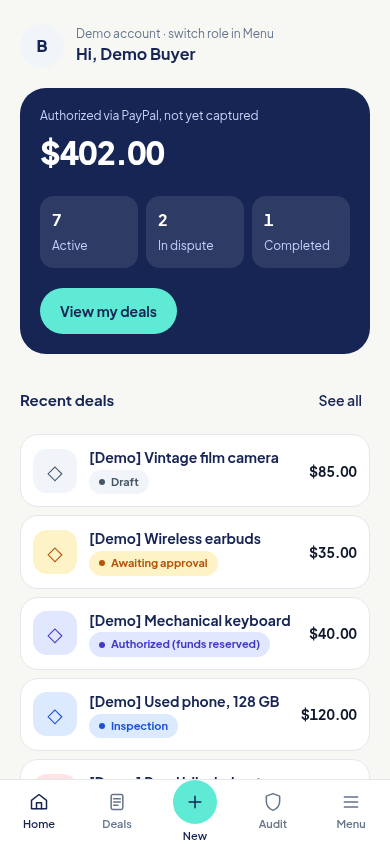

# HalcyVault (working name)

**A dispute-mediation prototype for peer-to-peer sales of physical goods.**
Rules first, AI summarises evidence, a human confirms every dispute outcome, and every
action is recorded in a hash-chained, auditable log. Built for the PayPal AI Hackathon 2026
on the **PayPal Sandbox**.

> This is a hackathon prototype. It is not a licensed escrow service, it does not hold
> anyone's money, and it does not handle real payments. PayPal authorizes the payment;
> the platform calls capture, void or refund according to the rules.



**Screens**

Captured from the running app with a fresh SQLite database, simulated PayPal,
and synthetic demo data. Mobile: 390 × 844, light. Desktop: 1440 × 900, dark.
The fairness screen shows recorded replay results with draft labels, not a live-model measurement.

| Screen | Mobile, light | Desktop, dark |
| --- | --- | --- |
| Buyer home | [View](docs/ui/screens/home-buyer.png) | [View](docs/ui/screens/home-dark.png) |
| Deals list | [View](docs/ui/screens/deals.png) | — |
| New deal, Phone checklist selected | [View](docs/ui/screens/new-phone.png) | — |
| Completed deal | [View](docs/ui/screens/deal-completed.png) | — |
| Evidence and damaged-dispute guidance | [View](docs/ui/screens/evidence-damaged.png) | — |
| Dispute review, reviewer | [View](docs/ui/screens/dispute-review.png) | [View](docs/ui/screens/review-dark.png) |
| Decision receipt | [View](docs/ui/screens/decision-receipt.png) | — |
| Audit detail | [View](docs/ui/screens/audit-detail.png) | — |
| Fairness results | [View](docs/ui/screens/fairness.png) | — |

## 1. The problem

In Indonesia, people buying second-hand goods from strangers often use a *rekber*
(rekening bersama, "joint account"): an admin holds the buyer's money until the item
arrives. It works when the admin is honest. When something goes wrong, the buyer and the
seller rely on one person's judgment, there is usually no record of why a decision was
made, and admins who side with a seller have been reported.

HalcyVault explores a different shape for the same job:

- the terms (item, condition, checks) are **locked and hashed before payment**,
- PayPal only **authorizes** the payment until the rules say release or refund,
- **deterministic rules** recommend the outcome; the AI only **summarises evidence**
  against the agreed checks and cannot move money,
- a **human reviewer** confirms every dispute outcome and must write a reason,
- every step is written to an **append-only, hash-chained audit log** that anyone with
  access can verify,
- the AI step is **tested for bias and prompt injection**, and the results are published
  with their limits.

**How it's different.** HalcyVault is built for the everyday case: two strangers trading a
used item over chat. There is no marketplace account and no listing, just a shared link.
Rules recommend, a person decides every dispute with a written reason, and we publish how
often the recommended outcome changes when only names, evidence order or writing style
change.

## 2. How it works

```
Seller writes terms ─▶ both accept (terms hash) ─▶ buyer approves on PayPal
   ─▶ AUTHORIZED (funds reserved, not captured)
   ─▶ seller adds tracking ─▶ buyer inspects
        ├─ confirms ─────────────────────────────▶ capture ─▶ COMPLETED
        ├─ no tracking by deadline ──────────────▶ void    ─▶ VOIDED
        └─ opens dispute ─▶ evidence from both sides
              ─▶ AI evidence summary ─▶ rules R1–R7 recommend
              ─▶ human reviewer decides (reason required)
                   ├─ release ─▶ capture ─▶ COMPLETED
                   ├─ refund  ─▶ void (or refund if captured)
                   └─ split   ─▶ recorded as pending, no money moves
A verified PayPal dispute or reversal webhook ─▶ FROZEN_EXTERNAL (PayPal's decision wins)
```

- **State machine** (`src/lib/domain/stateMachine.ts`): pure TypeScript. Each transition
  returns the one PayPal call it requires. Full table in [`docs/DESIGN.md`](docs/DESIGN.md#4-state-machine).
- **PayPal** (`src/lib/paypal/client.ts`): Orders v2 with `intent: AUTHORIZE`, then
  authorize, capture, void and refund. Every money-moving call sends a unique
  `PayPal-Request-Id`, the id is reserved in our database before the call, and an
  interrupted call is never sent twice. Webhooks are checked with PayPal's signature
  verification API and de-duplicated by event id. Right after a capture, the seller's
  tracking number is attached to the PayPal order (Orders v2 `/track`, carrier `OTHER`
  because the courier is simulated), so the PayPal transaction carries proof of shipment
  if the buyer later disputes there. PayPal only accepts tracking after capture; a failure
  never undoes the capture, is logged, and is retried up to three times.
- **Rules** (`src/lib/rules/engine.ts`):

  | Rule | Situation | Recommendation |
  | --- | --- | --- |
  | R1 | No tracking by the ship-by deadline | Void (no funds moved) |
  | R2 | Delivered to the agreed destination, no dispute in the window | Release |
  | R3 | Tracking destination or date inconsistent with the order | Human review |
  | R4 | Both sides gave evidence and the summary clearly supports one side | Recommend that side; a human confirms |
  | R5 | Evidence missing, contradictory, partial delivery or damage, or no usable AI summary | Human review (split possible) |
  | R6 | PayPal dispute or reversal event | Freeze |
  | R7 | Evidence looks like instructions aimed at the AI | Flag, ignore for scoring, human review |

- **AI evidence summary** (`src/lib/ai/evidence.ts`): for each agreed check the model
  returns strict JSON (which side the evidence supports, which evidence items, what is
  missing). Evidence is passed as quoted data, names are replaced by "Buyer" and
  "Seller", the order is shuffled with a seed, and invalid output is retried once and
  then treated as "no summary" (rule R5). The model has no tools: it cannot call PayPal
  or change a transaction.
- **Audit log** (`src/lib/audit/chain.ts`): each event stores
  `hash = SHA-256(prevHash + "\n" + canonical JSON of the event)`. The Audit screen
  verifies each chain and compares it with the latest signed checkpoint, showing
  "matches checkpoint", "extended since checkpoint", or "differs from checkpoint".
  New deals absent from the checkpoint are marked separately. Missing files or an
  invalid signature are shown plainly; they are not treated as a successful check.

  To publish head hashes outside the database:

  1. Run `npm run checkpoint -- --generate-key` in your own terminal. This prints
     a new Ed25519 pair once and writes only `audit-checkpoints/public-key.pem`.
     Store the private PEM in `.env` only, as a quoted multiline value named
     `AUDIT_SIGNING_KEY`. Never commit it, redirect the command output to a file,
     or share a terminal transcript containing it. The committed initial public key
     has no retained private key; this command replaces it before the first checkpoint.
  2. Run `npm run checkpoint`. It reads `.env`, verifies every transaction's audit
     chain from one SQLite snapshot, and writes `audit-checkpoints/<UTC timestamp>.json`.
     It refuses broken chains or a signing key that does not match the public key.
  3. Commit the public key and checkpoint JSON and publish them through your normal
     review process. People verifying later must keep a trusted copy of both outside
     the server. Writing the file locally does not publish it to GitHub automatically.

  A checkpoint signs the canonical JSON of `{createdAt, transactions}`, where each
  transaction entry contains `txId`, `length`, and `headHash`. `signature` is a
  base64 Ed25519 signature and is excluded from the signed payload. The verifier is
  `verifyCheckpoint()` in `src/lib/audit/checkpoint.ts`. An extended chain must still
  contain the old head at the recorded length. Generation refuses key rotation once
  checkpoint JSON exists; preserve old public keys and checkpoints before planning
  a rotation. This makes rewriting detectable by anyone holding the published
  checkpoint and trusted public key; it does not make rewriting impossible. The
  operator still controls the server and can replace its displayed files.
- **Making disputes easier to settle**: the seller can add a ready-made checklist per item
  type (phone, laptop, camera, headphones or speaker, game console), each check provable
  with a photo or video. The buyer picks a dispute type (not received, not as described,
  damaged, parts missing) and both sides see which evidence usually settles it. Neither
  changes the rules.
- **Decision receipt** (`/deals/[id]/decision`): after a dispute, both parties see the
  outcome, the reviewer's reason, what the rules recommended, the evidence with content
  hashes, and the decision's event in the audit chain.

## 3. What is real and what is simulated

| Part | In this prototype |
| --- | --- |
| PayPal authorize, capture, void, refund | Real **Sandbox** API calls when Sandbox keys are set |
| PayPal (optional) | `PAYPAL_MODE=simulated`: a clearly labelled local simulation, no PayPal calls, ids start with `SIM-` |
| Demo deals (Menu > "Load demo deals") | Simulated PayPal stub, ids start with `DEMO-`, items start with `[Demo]`; audit chains are real |
| Courier tracking | Simulated (`DEMO-DELIVERED`, `DEMO-IN-TRANSIT`, `DEMO-WRONG-DESTINATION`); the number is still sent to the PayPal Sandbox after capture |
| Seller payout | Not implemented. "Released" means captured to the platform's Sandbox merchant account |
| Photo evidence | Described in text; in-app camera capture is not built |
| Sign-in | Demo roles (buyer, seller, reviewer) chosen in Menu |
| AI summary | Replay of recorded outputs by default; live mode with any OpenAI-compatible API |
| Currency | USD only (the Sandbox flow was tested in USD) |

Every simulated money step carries `simulated: true` in the audit log, and deal pages show
a "Simulated payment" notice.

## 4. Run it yourself

Requirements: **Node.js 22.13 or newer** (uses the built-in `node:sqlite`).

```bash
git clone https://github.com/Ilham-Musyafa/HalcyVault.git
cd HalcyVault
npm ci
cp .env.example .env        # Windows PowerShell: Copy-Item .env.example .env
```

**Option A: no keys (fastest).** In `.env` set:

```
PAYPAL_MODE=simulated
EVAL_K=3
```

Then `npm run dev` and open http://localhost:3000. Pick a role in Menu, create a deal as
the seller, switch to the buyer to accept and pay, back to the seller to add tracking
`DEMO-DELIVERED`, then confirm or open a dispute as the buyer. Menu > "Load demo deals"
adds eleven labelled sample deals across the main statuses, including a finished dispute
with a decision receipt and a dispute ready for the reviewer.

**Option B: PayPal Sandbox.** Create a Sandbox app at developer.paypal.com and set
`PP_ID`, `PP_SECRET` and `PP_URL=https://api-m.sandbox.paypal.com` in `.env` (leave
`PAYPAL_MODE` empty). The buyer approves with a Sandbox **Personal** account. The client
refuses any URL other than the Sandbox. Never commit `.env`.

Optional settings in `.env`:

- `AI_MODE=live`, `AI_BASE_URL`, `AI_API_KEY`, `AI_MODEL`: use a live OpenAI-compatible
  model for evidence summaries instead of the recorded replays.
- `EVAL_K`: number of consistency runs for `npm run eval` (1–20). Keep it set to `3`
  for the copied `.env.example`; an empty value makes the evaluation command fail.
- `SHIP_BY_DAYS`, `INSPECTION_DAYS`, `EVIDENCE_DAYS`: deadlines (defaults 3, 2, 2).
- `PP_WEBHOOK_ID`: needed for PayPal webhook signature verification.
- `HALCYVAULT_DB_PATH`: SQLite file location (default `data/halcyvault.sqlite`).

Checks:

```bash
npm test            # unit and route tests, no keys needed
npm run typecheck
npm run build
npm run eval        # writes eval/report.md (replay mode without an AI key)
npm run smoke       # real PayPal Sandbox walk-through from the terminal, reads .env
```

The JSON API behind the screens lives in `src/app/api/**` (for example
`POST /api/transactions`, `.../accept`, `.../pay`, `.../ship`, `.../confirm`,
`.../dispute`, `.../evidence`, `.../review`, `GET /api/audit/{id}`,
`GET /api/audit/verify`). Each request names its demo role in the `x-demo-role` header.

## 5. Test results

**PayPal Sandbox** ([`docs/SANDBOX-NOTES.md`](docs/SANDBOX-NOTES.md)): create order
(AUTHORIZE), buyer approval, authorize, capture, full refund and void were tested by hand
against the Sandbox. Void after capture is rejected (`PREVIOUSLY_CAPTURED`) and authorize
before approval is rejected (`ORDER_NOT_APPROVED`); the state machine is built around both.
A 10.00 USD capture showed a 0.64 USD fee that did not appear to be returned on refund.

**Fairness and robustness harness** ([`eval/report.md`](eval/report.md)): 50 synthetic
cases (40 disputes, 10 prompt-injection attempts), each also run with six counterfactual
variants (swapped names, reversed evidence order, longer and shorter stories, formal and
informal wording). It measures false-release and false-refund rates and the gap between
them, how often a variant changes the outcome, consistency over repeated runs,
escalation rate, and injection success.

Read these numbers with their limits: the current report runs in **replay mode**, the
labels are drafts, and the replayed summaries were written from those labels. It checks
the harness, the rules and the injection flag. It does **not** yet measure a live model.
A run with a live model, with reviewed labels and its sample size, is planned.

The same numbers are shown in the app on the **Fairness results** page (`/fairness`, from
`eval/results.json`), with the same limits stated on the page.

## 6. Limitations and production path

- The platform operator is still trusted: it runs the server, holds the PayPal keys and
  calls capture or refund. The audit log makes its actions checkable, not impossible to
  misuse.
- An authorization has a 3-day honor period and expires after 29 days, so long shipping
  times need a different fund model (capture first, refund on dispute), which brings
  custody questions.
- Split outcomes are recorded but not paid out.
- PayPal does not return its fee on a refund (seen in the Sandbox). The platform bears it,
  so a buyer who is refunded gets the full amount back.
- No real sign-in, file upload, courier integration or seller payout. Real tracking would
  use a multi-carrier tracking API with the courier chosen by the seller.
- A real launch would need funds held by a licensed party (for example a PayPal
  partner product with delayed disbursement, or a licensed payment provider), PayPal's
  approval (its Acceptable Use Policy lists escrow services and marketplaces as needing
  pre-approval), and local licensing review in Indonesia. This is not legal advice.
- Later, the same rules-first pattern could extend to milestone-based services, such as
  home renovation paid per stage, with one PayPal order per milestone.

## 7. Tech stack and AI tools

- Next.js 16 (App Router), React 19, TypeScript, Tailwind CSS 4, SQLite through
  `node:sqlite`, Vitest. Three runtime dependencies: `next`, `react`, `react-dom`.
- Plus Jakarta Sans, self-hosted under the SIL Open Font License.
- Built by one developer with AI coding assistants (Claude Code and OpenAI Codex).
  Agent rules are in [`AGENTS.md`](AGENTS.md); working notes in
  [`docs/HANDOFF.md`](docs/HANDOFF.md).
- Design docs: [`docs/DESIGN.md`](docs/DESIGN.md), [`docs/UI.md`](docs/UI.md).

## 8. License

[MIT](LICENSE).
